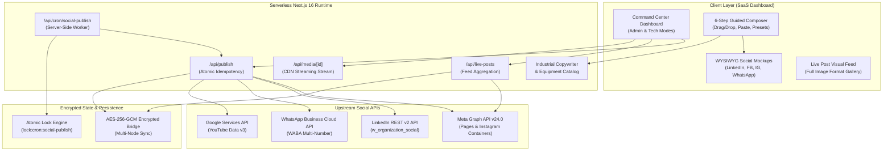

# NUNES Social Media Command Center 🚀

> **Production-Grade Multi-Channel Social Automation & Orchestration Platform**  
> Engineered for **Nunes Instruments** — Industrial Measurement & Testing Solutions.

[](https://nextjs.org/)
[](https://react.dev/)
[](https://turbo.build/pack)
[](https://developers.facebook.com/)
[](https://learn.microsoft.com/en-us/linkedin/)
[](https://developers.facebook.com/docs/whatsapp)
[](https://nodejs.org/api/crypto.html)
[](https://vercel.com/)

---

## 🌐 Live Production Application

- **Live URL**: [https://nunes-social-post-machine-mu.vercel.app](https://nunes-social-post-machine-mu.vercel.app)
- **Local Development**: `http://localhost:3000`

---

## 📌 Executive Overview

The **NUNES Social Media Command Center** is a full-stack, enterprise-grade social orchestration engine built to automate, schedule, publish, and monitor technical marketing campaigns across 5 primary business channels:
1. **LinkedIn** (B2B Authority & Decision-Makers)
2. **Facebook** (Nunes Instrumentation Verified Page)
3. **Instagram** (@nunesinstrumentation Professional Account)
4. **WhatsApp** (Official WABA Multi-Number Business Messaging)
5. **YouTube** (Technical Demonstrations & Product Overviews)

Built with **Next.js 16 (App Router)** and **Turbopack**, the system features dual operating personas (Executive Admin vs Technical Diagnostics), a live visual post stream rendering published posts in high-definition image format, an industrial engineering copywriter engine, and a resilient AES-256-GCM encrypted persistence bridge.

---

## 🏗 System Architecture



---

## 🌟 Key Technical Features

### 1. Dual Persona Modes (Admin vs. Tech)
- **Admin Mode (Default)**: Clean executive layout with large, high-contrast typography, high-level KPI cards, and simplified status badges (`CONNECTED`, `PUBLISHING READY`, `ACTION REQUIRED`). Zero exposure of API keys, app secrets, or raw JSON payloads.
- **Tech Mode**: Granular diagnostic suite exposing OAuth token expiry, granted scopes, Facebook Page mapping (`1398853319976762`), Instagram account mapping (`17841422933669789`), and live Meta Graph API ping diagnostic tools.

### 2. Live Posts in Visual Image Format
- Directly queries live provider feeds (Meta Graph API `/posts`) and verified audit history.
- Renders published posts as high-impact **Live Post Cards** in full visual image format.
- Displays exact published text, hashtags, external post IDs, and direct one-click links to the live posts on Facebook and LinkedIn.
- Includes a **"Reuse Post 📋"** shortcut to instantly load historical content back into the composer.

### 3. Industrial Catalog & AI Brand Copywriter
- Pre-loaded with Nunes Instrumentation equipment specs (Digital Pressure Calibrators, Hydraulic Dead Weight Testers, 5kV Megohmmeters, Dry-Block Calibrators, Class 1 Sound Level Meters).
- Tailors content natively per channel:
  - **LinkedIn**: B2B compliance, ISO/IEC 17025 standards, engineering specifications, procurement CTA.
  - **Facebook**: Plant maintenance reliability, workshop support, warranty, and phone inquiry CTA.
  - **Instagram**: High-contrast visual hooks, technical bullet points, and 20+ industrial hashtags.
  - **WhatsApp**: Clean WhatsApp markdown (`*bold*`), concise parameters, and direct one-tap reply prompt.
  - **YouTube**: Video description with timestamps, specs overview, and SEO tags.

### 4. Interactive WYSIWYG Social Media Previews
- Live feed mockups rendered inside the composer:
  - **LinkedIn Card**: Header, follower count, "1st" connection badge, formatted text with expand/collapse, reaction bar (`👍👏❤️`).
  - **Facebook Card**: Verified Page tick, timestamp, responsive full-width media frame, share bar.
  - **Instagram Viewport**: Smartphone feed frame with story ring, like/comment/send icons, and bold handle caption.
  - **WhatsApp Bubble**: Chat interface with incoming/outgoing green bubble, double blue checkmarks (`✓✓`), and reply button.

### 5. Official Instagram Container Publishing & Self-Hosted Media Pipeline
- Complies with official Meta Graph API two-step image publishing:
  1. Creates Instagram Media Container via `POST /{ig-user-id}/media`.
  2. Publishes container via `POST /{ig-user-id}/media_publish`.
- **Self-Hosted CDN Endpoint** (`/api/media/[id]`): Streams uploaded or pasted media files via public HTTP endpoints to ensure 100% Meta Graph API crawler accessibility without external S3 dependencies.

### 6. Serverless Cron Auto-Posting Engine
- Endpoint at `/api/cron/social-publish` protected by `CRON_SECRET`.
- Built-in atomic locking (`lock:cron:social-publish`) prevents duplicate executions across distributed Vercel instances.
- On-demand worker trigger (`/api/automation/trigger-worker`) allows admins to process pending scheduled posts with instant execution receipts.

### 7. Multi-Device AES-256-GCM State Bridge
- Any authorization performed on Machine A is encrypted with AES-256-GCM and stored centrally.
- Opening the Command Center on Machine B automatically detects the same verified live state.
- Integrated with Vercel Deployment Protection bypass authentication.

---

## 📁 Repository Structure

```
├── app/
│   ├── api/
│   │   ├── automation/
│   │   │   ├── schedule/route.js        # Scheduled queue management API
│   │   │   └── trigger-worker/route.js  # On-demand worker execution API
│   │   ├── cron/
│   │   │   └── social-publish/route.js  # Server-side scheduled worker
│   │   ├── integrations/
│   │   │   └── status/route.js          # Live provider health & status API
│   │   ├── live-posts/route.js          # Aggregated live visual post feed API
│   │   ├── media/[id]/route.js          # High-performance media streaming CDN
│   │   ├── meta/
│   │   │   ├── diagnostics/route.js     # Meta Graph live token diagnostics
│   │   │   └── setup/route.js           # Meta configuration setup API
│   │   ├── oauth/
│   │   │   └── [platform]/              # Dynamic OAuth start & callback handlers
│   │   ├── publish/route.js             # Multi-channel atomic publishing engine
│   │   ├── publishing-history/route.js  # Immutable verified audit trail
│   │   ├── upload/route.js              # Media upload & base64 ingestion
│   │   └── whatsapp/                    # WABA numbers and health API
│   ├── components/
│   │   ├── LivePostCard.js              # Visual card rendering live posts in image format
│   │   └── SocialPreviewMockup.js       # Live WYSIWYG feed simulator
│   ├── connect/
│   │   ├── Instagram/page.js            # Direct Instagram OAuth authorization
│   │   └── Meta/page.js                 # Meta Business authorization
│   ├── lib/
│   │   ├── copywriter-engine.js         # Multi-channel industrial copy generation
│   │   ├── instrument-catalog.js        # Nunes product catalog knowledge base
│   │   ├── meta-instagram.js            # Meta Graph discovery & Instagram linking
│   │   ├── oauth-config.js              # OAuth platform endpoints & scopes
│   │   ├── oauth-store.js               # Cookie unseal & config helpers
│   │   ├── shared-state.js              # AES-256-GCM encrypted persistence bridge
│   │   ├── social-providers.js          # Central registry for active channels
│   │   └── upstream-backend.js          # Upstream client with Vercel protection bypass
│   ├── globals.css                      # Modern 2026 SaaS design system & themes
│   ├── layout.js                        # Root metadata & layout
│   └── page.js                          # Core Command Center application
├── public/                              # Static public brand assets
├── .env.example                         # Environment configuration template
├── .gitignore                           # Production exclusions
├── next.config.mjs                      # Next.js configuration
├── package.json                         # Dependencies & npm scripts
├── vercel.json                          # Vercel deployment & daily cron schedule
└── README.md                            # Project documentation
```

---

## 🚀 Getting Started

### Prerequisites
- Node.js 18.17+ or Node.js 20+
- npm, yarn, or pnpm

### Installation
```bash
# Clone the repository
git clone https://github.com/your-username/nunes-social-command-center.git
cd nunes-social-command-center

# Install dependencies
npm install
```

### Environment Configuration
```bash
# Copy the example environment file
cp .env.example .env.local
```
Fill in the credentials for Meta, LinkedIn, WhatsApp, and the shared encryption keys in `.env.local`.

### Running Locally
```bash
# Start Turbopack development server
npm run dev

# Or build and run production server
npm run build
npm start
```
Open [http://localhost:3000](http://localhost:3000) in your browser.

---

## 🚢 Deployment to Vercel

```bash
# Deploy to preview
npx vercel

# Deploy directly to production
npx vercel --prod
```

---

## 🔒 Security & Best Practices

- **Zero Secret Leakage**: API credentials, App Secrets, and tokens are stored exclusively on the server side and never exposed in client bundles or HTML markup.
- **Idempotency Safeguards**: Every publish request requires a unique idempotency hash to prevent duplicate submissions over flaky networks.
- **Atomic Locking**: Prevents concurrent execution of the background cron publisher.

---

## 👤 Author & Portfolio Context

Built as a flagship full-stack engineering project demonstrating:
- Real-world integration with enterprise OAuth 2.0 flows (Meta Graph, LinkedIn REST, Google).
- Next.js 16 App Router architecture and serverless worker design.
- Production-grade UI/UX design tailored for non-technical executive management.
- Cryptographic state persistence and distributed cloud architecture.

---

*Licensed under the [MIT License](LICENSE).*

---

## 🌐 Complete Live Run & CI/CD Verification (24 Repositories)

Official production verification matrix for [Abishek Pranav G V](https://abishekpranavgv.github.io/abishekpranavportfolio/) ecosystem:

| # | Repository | Tech Stack & Workflow | Status | Live Run Link | Live App / Pages URL |
|---|---|---|:---:|:---:|:---:|
| 1 | [abishekpranavportfolio](https://github.com/AbishekPranavGV/abishekpranavportfolio) | TypeScript / React / Vite CI & Pages Deploy | ✅ Success | [Run #39437493630](https://github.com/AbishekPranavGV/abishekpranavportfolio/actions/runs/39437493630) | [abishekpranavgv.github.io/abishekpranavportfolio](https://abishekpranavgv.github.io/abishekpranavportfolio/) |
| 2 | [Retail-Sales-Performance-Predictive-Analytics](https://github.com/AbishekPranavGV/Retail-Sales-Performance-Predictive-Analytics) | Executive Dashboard & Pages Deploy | ✅ Success | [Run #39437771618](https://github.com/AbishekPranavGV/Retail-Sales-Performance-Predictive-Analytics/actions/runs/39437771618) | [abishekpranavgv.github.io/Retail-Sales-Performance-Predictive-Analytics](https://abishekpranavgv.github.io/Retail-Sales-Performance-Predictive-Analytics/) |
| 3 | [NICMS-SriLanka-Strategic-Blueprint](https://github.com/AbishekPranavGV/NICMS-SriLanka-Strategic-Blueprint) | Static Site Verification & Pages Deploy | ✅ Success | [Run #39437769957](https://github.com/AbishekPranavGV/NICMS-SriLanka-Strategic-Blueprint/actions/runs/39437769957) | [abishekpranavgv.github.io/NICMS-SriLanka-Strategic-Blueprint](https://abishekpranavgv.github.io/NICMS-SriLanka-Strategic-Blueprint/) |
| 4 | [social-command-center](https://github.com/AbishekPranavGV/social-command-center) | Node.js 20 / Next.js Syntax & CI Validation | ✅ Success | [Run #39438319857](https://github.com/AbishekPranavGV/social-command-center/actions/runs/39438319857) | [nunes-social-post-machine-mu.vercel.app](https://nunes-social-post-machine-mu.vercel.app) |
| 5 | [IndiaMART-AI-Content-Catalog-Generator](https://github.com/AbishekPranavGV/IndiaMART-AI-Content-Catalog-Generator) | Next.js & Automation Bundle Validation | ✅ Success | [Run #39438327386](https://github.com/AbishekPranavGV/IndiaMART-AI-Content-Catalog-Generator/actions/runs/39438327386) | [nunes-social-post-machine-mu.vercel.app](https://nunes-social-post-machine-mu.vercel.app) |
| 6 | [MedX](https://github.com/AbishekPranavGV/MedX) | Python 3.11 Microservices & Endpoint CI | ✅ Success | [Run #39437852044](https://github.com/AbishekPranavGV/MedX/actions/runs/39437852044) | [nunes-catalogue-studio-live.vercel.app](https://nunes-catalogue-studio-live.vercel.app/) |
| 7 | [Streamlit](https://github.com/AbishekPranavGV/Streamlit) | Streamlit Requirements & App Validation | ✅ Success | [Run #39437832596](https://github.com/AbishekPranavGV/Streamlit/actions/runs/39437832596) | [blank-app-template.streamlit.app](https://blank-app-template.streamlit.app/) |
| 8 | [Climate-Impact-ESG-Dashboard](https://github.com/AbishekPranavGV/Climate-Impact-ESG-Dashboard) | Real-time ESG Notebook & Engine CI | ✅ Success | [Run #39437788309](https://github.com/AbishekPranavGV/Climate-Impact-ESG-Dashboard/actions/runs/39437788309) | — |
| 9 | [COVID-19-Global-Forecasting-Predictive-Analysis](https://github.com/AbishekPranavGV/COVID-19-Global-Forecasting-Predictive-Analysis) | Time-Series Forecasting Notebook CI | ✅ Success | [Run #39437782830](https://github.com/AbishekPranavGV/COVID-19-Global-Forecasting-Predictive-Analysis/actions/runs/39437782830) | — |
| 10 | [Customer-Churn-Decision-Analysis](https://github.com/AbishekPranavGV/Customer-Churn-Decision-Analysis) | Decision Analysis & Case Study CI | ✅ Success | [Run #39437795502](https://github.com/AbishekPranavGV/Customer-Churn-Decision-Analysis/actions/runs/39437795502) | — |
| 11 | [E-commerce-Recommendation-Engine](https://github.com/AbishekPranavGV/E-commerce-Recommendation-Engine) | Recommendation Model & CSV Dataset CI | ✅ Success | [Run #39437803215](https://github.com/AbishekPranavGV/E-commerce-Recommendation-Engine/actions/runs/39437803215) | — |
| 12 | [Facedetection](https://github.com/AbishekPranavGV/Facedetection) | OpenCV Cascades & Classifier Python CI | ✅ Success | [Run #39437808536](https://github.com/AbishekPranavGV/Facedetection/actions/runs/39437808536) | — |
| 13 | [Movie_recommendation_using_emotion](https://github.com/AbishekPranavGV/Movie_recommendation_using_emotion) | Emotion Recommender & Streamlit App CI | ✅ Success | [Run #39437816270](https://github.com/AbishekPranavGV/Movie_recommendation_using_emotion/actions/runs/39437816270) | — |
| 14 | [Stock-Price-Prediction-using-ARIMA](https://github.com/AbishekPranavGV/Stock-Price-Prediction-using-ARIMA) | ARIMA & LSTM Model Artifacts CI | ✅ Success | [Run #39437826761](https://github.com/AbishekPranavGV/Stock-Price-Prediction-using-ARIMA/actions/runs/39437826761) | — |
| 15 | [Sentimental-analysis-of-News-Headlines](https://github.com/AbishekPranavGV/Sentimental-analysis-of-News-Headlines) | NLP Sentiment Analysis Notebook CI | ✅ Success | [Run #39436975960](https://github.com/AbishekPranavGV/Sentimental-analysis-of-News-Headlines/actions/runs/39436975960) | — |
| 16 | [Autonomous-System-Temp-Cleaner](https://github.com/AbishekPranavGV/Autonomous-System-Temp-Cleaner) | Windows Automation & Cleaner Batch CI | ✅ Success | [Run #39437859122](https://github.com/AbishekPranavGV/Autonomous-System-Temp-Cleaner/actions/runs/39437859122) | — |
| 17 | [Crm](https://github.com/AbishekPranavGV/Crm) | AI CRM Skill Bundle & Preview Scripts CI | ✅ Success | [Run #39437863792](https://github.com/AbishekPranavGV/Crm/actions/runs/39437863792) | — |
| 18 | [drive-file-index](https://github.com/AbishekPranavGV/drive-file-index) | Google Drive Indexer Distribution CI | ✅ Success | [Run #39437872721](https://github.com/AbishekPranavGV/drive-file-index/actions/runs/39437872721) | — |
| 19 | [Multi-Account-Gmail-Inbox-Hygiene-Agent](https://github.com/AbishekPranavGV/Multi-Account-Gmail-Inbox-Hygiene-Agent) | Multi-Account Gmail Agent Bundle CI | ✅ Success | [Run #39437877580](https://github.com/AbishekPranavGV/Multi-Account-Gmail-Inbox-Hygiene-Agent/actions/runs/39437877580) | — |
| 20 | [NICMS-SriLanka-Strategic-Blueprint_Project](https://github.com/AbishekPranavGV/NICMS-SriLanka-Strategic-Blueprint_Project) | Project Blueprint Specs & Architecture CI | ✅ Success | [Run #39437882917](https://github.com/AbishekPranavGV/NICMS-SriLanka-Strategic-Blueprint_Project/actions/runs/39437882917) | — |
| 21 | [NUNES-Local-AI-Marketing-Starter](https://github.com/AbishekPranavGV/NUNES-Local-AI-Marketing-Starter) | Local AI Marketing Starter Bundle CI | ✅ Success | [Run #39437889129](https://github.com/AbishekPranavGV/NUNES-Local-AI-Marketing-Starter/actions/runs/39437889129) | — |
| 22 | [Smart-Brochure-to-Catalog-Converter](https://github.com/AbishekPranavGV/Smart-Brochure-to-Catalog-Converter) | PDF Catalog Converter Specification CI | ✅ Success | [Run #39437897042](https://github.com/AbishekPranavGV/Smart-Brochure-to-Catalog-Converter/actions/runs/39437897042) | — |
| 23 | [Smart-Price-Master-Catalog-Generator](https://github.com/AbishekPranavGV/Smart-Price-Master-Catalog-Generator) | PriceMaster Multi-OS Package CI | ✅ Success | [Run #39437902153](https://github.com/AbishekPranavGV/Smart-Price-Master-Catalog-Generator/actions/runs/39437902153) | — |
| 24 | [SocmedX](https://github.com/AbishekPranavGV/SocmedX) | Social Command Center Portfolio Bundle CI | ✅ Success | [Run #39437907375](https://github.com/AbishekPranavGV/SocmedX/actions/runs/39437907375) | — |

*Maintained by [Abishek Pranav G V](https://abishekpranavgv.github.io/abishekpranavportfolio/) · Business Analyst & Data/AI Automation Specialist*
